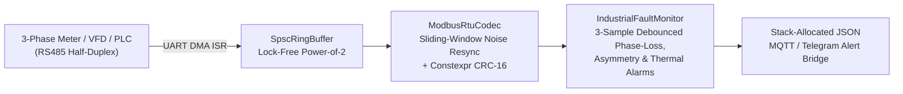

# IIoT Modbus-RTU Edge Gateway & Industrial Fault Engine (Zero-Heap Embedded C++17)

[](https://github.com/Danhle23/iiot-modbus-edge-gateway/actions/workflows/ci.yml)


A deterministic, **zero-dynamic-allocation (`no malloc / no std::string`)** industrial telemetry and fault-detection engine written in modern **Embedded C++17**. Designed to retrofit legacy factory switchgear, 3-phase inverters, and cold-storage PLC cabinets over opto-isolated **RS485 (Modbus-RTU)** and stream real-time alarm payloads to **MQTT / SCADA / Cloud** endpoints.

---

## System Architecture



---

## Core Engineering Highlights

- **Compile-Time `constexpr` CRC-16/MODBUS (`include/iiot/crc16.hpp`):** Generates the 256-entry `0xA001` reflected lookup table in Flash/ROM at compile time for $O(1)$ per-byte checksum verification with zero RAM overhead.
- **Lock-Free SPSC DMA Ring Buffer (`include/iiot/ring_buffer.hpp`):** C++11/17 `std::atomic` acquire/release single-producer single-consumer queue with compile-time power-of-2 bitmask wrapping — safe for high-baud UART DMA interrupts feeding a `FreeRTOS` worker task without disabling interrupts.
- **EMI Noise-Resilient Stream Parser (`include/iiot/modbus_rtu.hpp`):** Handles half-duplex RS485 transceiver turnaround glitches (`0xFF`/`0x00` leading bytes) via sliding-window 1-byte resynchronization, supporting `FC 0x03`, `FC 0x04`, `FC 0x06`, and `0x80+` exception frames.
- **Debounced 3-Phase & Cold-Chain Protection (`include/iiot/fault_monitor.hpp`):** Filters out transient motor-inrush dips while latching genuine **phase loss (`< 175V`)**, **phase voltage imbalance (`> 25V`)**, **over-current**, and **cold-storage thermal excursions** into zero-heap stack JSON buffers.

---

## Quick Start & Verification

```bash
# 1. Build and run strict C++17 unit verification (-Wall -Wextra -Werror -pedantic)
make test

# 2. Run virtual RS485 PLC cabinet & fault-injection telemetry demo
make demo
```

---

## Author

**Lê Thanh Danh** — Electronics & Telecommunications Engineering, VNUHCM - University of Science  
GitHub: [@Danhle23](https://github.com/Danhle23) · Email: [danhle2305@gmail.com](mailto:danhle2305@gmail.com)
